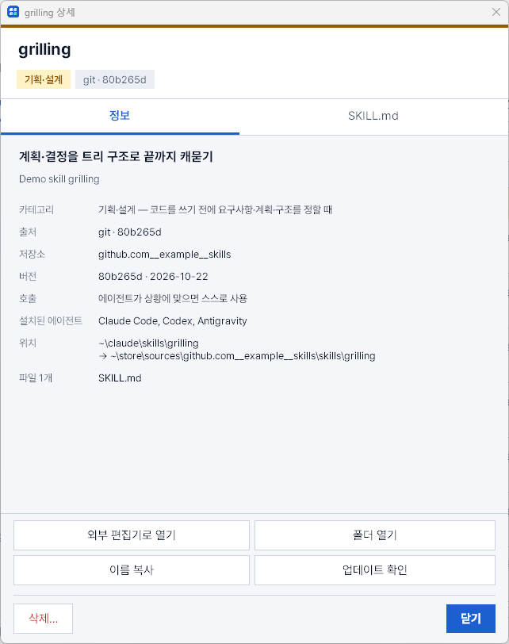
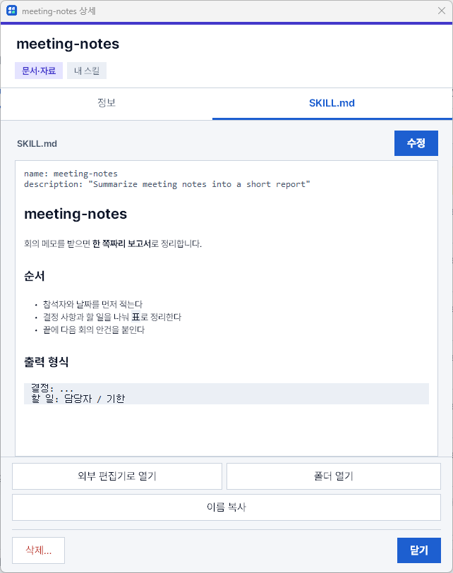
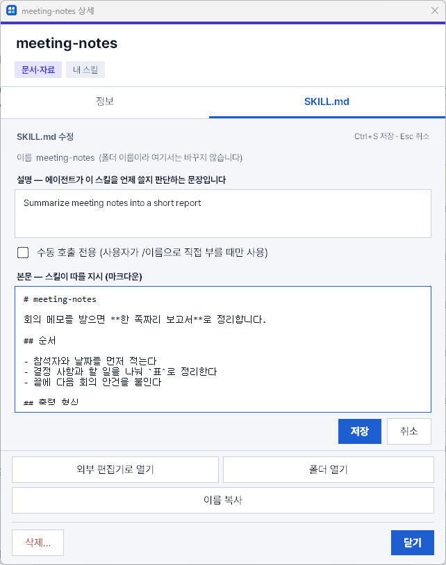
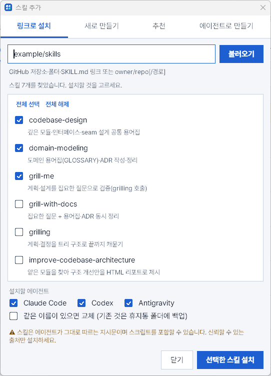
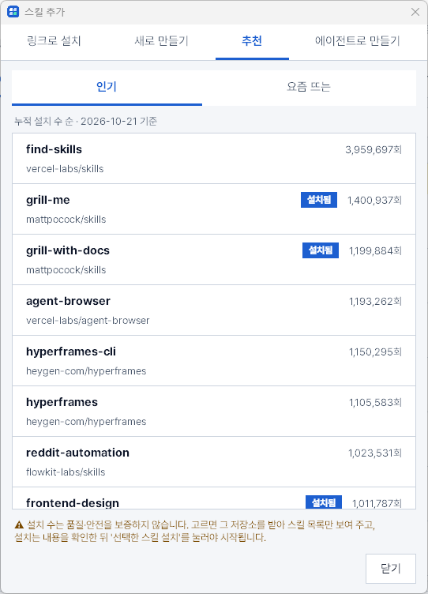
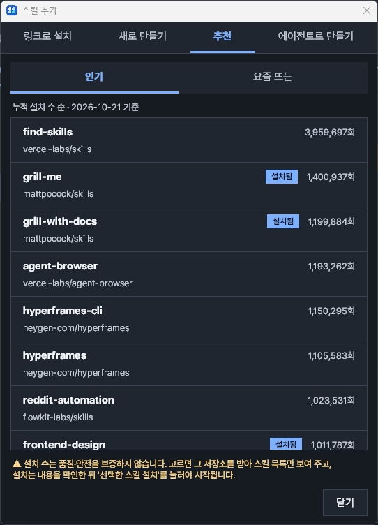
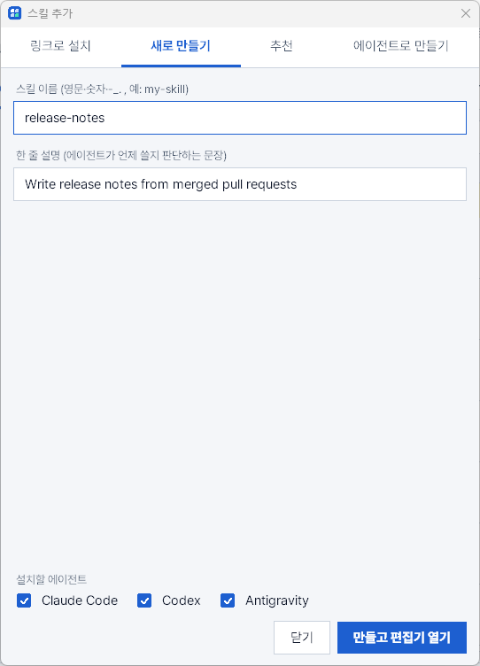
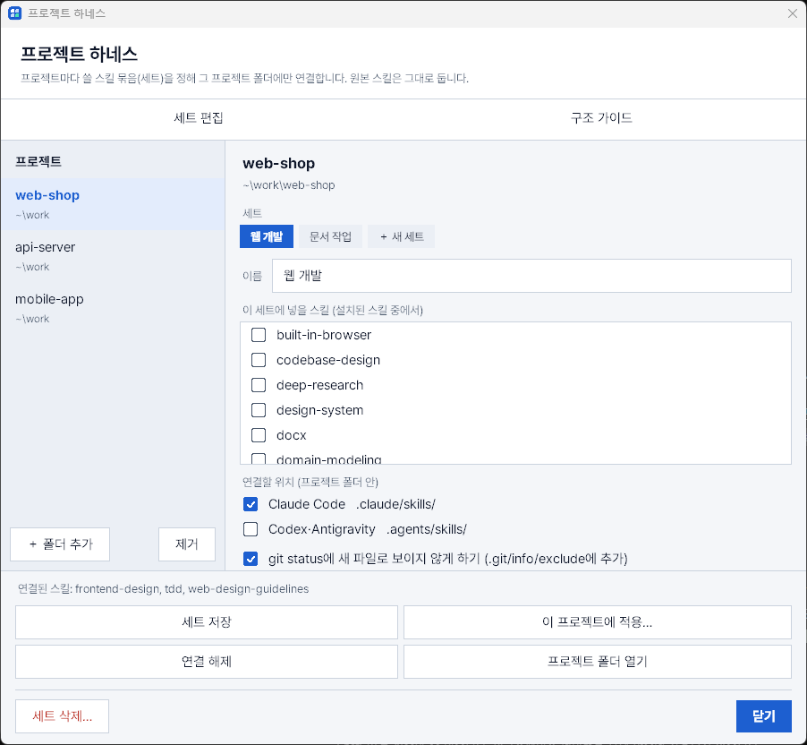
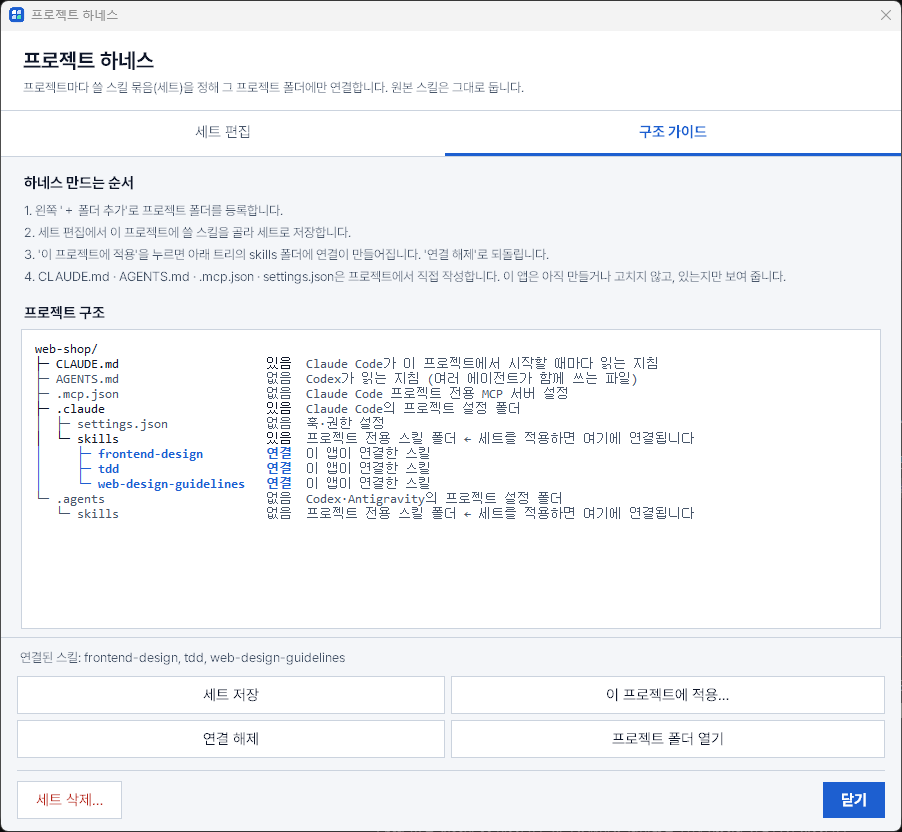

# SkillDesk

[](https://github.com/sgustjd2/skill-manage-viewer/actions/workflows/ci.yml)

내 PC에 설치된 **AI 에이전트 스킬**(Claude Code · Codex · Antigravity)을 한 화면에서 보고, 설치·업데이트·수정·삭제까지 하는 **Windows·macOS** 프로그램입니다.
작은 창이 화면 모서리에 떠 있고, 트레이(macOS는 메뉴 막대) 아이콘으로 열고 닫습니다.


> 스크린샷은 Windows에서 예시 스킬로 찍은 것입니다. macOS도 화면 구성은 같습니다.

## 목차

- [이런 걸 할 수 있어요](#이런-걸-할-수-있어요)
- [빠른 시작 (5분)](#빠른-시작-5분)
- [자세한 설치 방법](#자세한-설치-방법)
- [자동 업데이트](#자동-업데이트)
- [화면 구성](#화면-구성)
- [사용 방법](#사용-방법)
- [카테고리 기준](#카테고리-기준)
- [스킬은 어디서 읽어 오나요](#스킬은-어디서-읽어-오나요)
- [안전장치와 저장 위치](#안전장치와-저장-위치)
- [문제 해결 (FAQ)](#문제-해결-faq)
- [개발에 참여하기](#개발에-참여하기)

## 이런 걸 할 수 있어요

| 기능 | 설명 |
|---|---|
| 한눈에 보기 | 세 에이전트의 스킬을 탭으로 나눠 보여 주고, 왼쪽 **카테고리 목록**에서 고르면 그 카테고리 스킬만 나옵니다. |
| 무엇에 쓰는지 | 스킬마다 **한국어 한 줄 용도**를 붙였습니다. 직접 고칠 수도 있습니다. |
| 어디서 왔는지 | 스킬 오른쪽에 **출처**(git 커밋, 로컬, 플러그인 …)가 보여서 관리할 수 있는 스킬인지 바로 압니다. |
| 자주 쓰는 스킬 | 스킬 이름 앞의 **☆**를 눌러 **★**로 지정하면 왼쪽 맨 위 **★ 자주 쓰는 스킬**에 모아 보입니다. 에이전트마다 따로 저장됩니다. |
| 많이 쓴 스킬 | Claude Code 탭의 **많이 쓴 스킬**에서 이번 달(또는 다른 달·전체 기간)에 스킬을 몇 번 불렀는지 **많은 순**으로 봅니다. 안 쓰는 스킬을 정리할 때 쓰세요. |
| 정리 후보 | Claude Code 탭 왼쪽 목록 **맨 아래**의 **정리 후보**에서 최근 2개월 동안 한 번도 쓰지 않은 스킬을 오래 안 쓴 순으로 보고, 체크해서 **한 번에 삭제**합니다(링크는 끊고, 실제 폴더는 휴지통으로). |
| 링크로 설치 | GitHub 링크나 `owner/repo`를 넣으면 그 안의 스킬을 찾아 보여 주고, 고른 것만 설치합니다. |
| 추천 | `＋ 추가`의 **추천** 탭에서 skills.sh의 **인기**·**요즘 뜨는** 스킬을 설치 수와 함께 보고, 고르면 링크로 설치 흐름으로 이어집니다. 이미 설치한 스킬에는 **설치됨**이 붙습니다. |
| 프로젝트 하네스 | 헤더의 **프로젝트** 버튼으로 여는 창에서 프로젝트 폴더마다 **스킬 세트**를 정해 그 폴더에만 연결합니다. **구조 가이드** 탭은 프로젝트의 에이전트 설정(`CLAUDE.md`, `.claude/skills` …)을 트리로 보여 줍니다. |
| 업데이트 | git으로 받은 스킬에 새 버전이 있는지 확인하고 한 번에 받습니다. |
| 새로 만들기·수정·삭제 | 스킬 템플릿을 만들어 편집기로 열고, 수정·삭제도 여기서 합니다. 삭제한 폴더는 휴지통 폴더로 옮겨져 되살릴 수 있습니다. |
| 보기 편하게 | 밝은/어두운 화면, 화면 가운데에 뜨는 창, 카테고리별 색, Pretendard 글꼴, 모든 글씨의 대비 기준(WCAG AA) 충족. |

## 빠른 시작 (5분)

이미 Python 3.12 이상과 Git이 있다면 이것만 하면 됩니다. 없다면 [자세한 설치 방법](#자세한-설치-방법)부터 보세요.

**Windows** (명령 프롬프트 또는 PowerShell)

```bash
git clone https://github.com/sgustjd2/skill-manage-viewer.git
cd skill-manage-viewer
.\start.bat
python install.py
```

**macOS** (터미널)

```bash
git clone https://github.com/sgustjd2/skill-manage-viewer.git
cd skill-manage-viewer
./start.command
python3 install.py
```

1. `start.bat` / `start.command`: 필요한 패키지가 없으면 설치하고 앱을 띄웁니다.
2. `install.py`: 앞으로 **시작 메뉴(Windows) / Spotlight(macOS)** 에서 `SkillDesk`로 검색해 켤 수 있게 등록합니다.

## 자세한 설치 방법

### 1. 필요한 것

| 항목 | Windows | macOS |
|---|---|---|
| 운영체제 | Windows 10 / 11 | macOS 10.15 (Catalina) 이상 |
| Python | 3.12 이상 | 3.12 이상 (Tk 8.6 포함 버전) |
| Git | 링크로 설치·업데이트할 때 필요 | 같음 |

### 2. Python 설치

**Windows**

- [python.org 다운로드](https://www.python.org/downloads/)에서 Python 3.12 이상을 받아 실행합니다.
- 첫 화면 아래의 **Add python.exe to PATH**를 꼭 체크하고 **Install Now**를 누릅니다.
- 또는 터미널에서 `winget install Python.Python.3.12`
- 확인: 새 터미널에서 `python --version` → `Python 3.12.x` 이상이면 됩니다.

**macOS**

- 권장: [python.org](https://www.python.org/downloads/macos/)의 macOS 설치 프로그램(Tk 8.6이 함께 들어 있습니다).
- Homebrew를 쓴다면: `brew install python@3.12 python-tk@3.12`
- 확인: `python3 --version`, 그리고 `python3 -c "import tkinter; print(tkinter.TkVersion)"`이 `8.6`이면 됩니다.

> ⚠ macOS에 기본으로 있는 `/usr/bin/python3`는 Tk 8.5라 창이 비어 보일 수 있습니다. 위 방법으로 설치한 Python을 쓰세요.

### 3. Git 설치 (링크 설치·업데이트를 쓸 때)

- Windows: [git-scm.com](https://git-scm.com/download/win) 또는 `winget install Git.Git`
- macOS: `xcode-select --install` 또는 `brew install git`
- 확인: `git --version`

### 4. 프로그램 받기

```bash
git clone https://github.com/sgustjd2/skill-manage-viewer.git
```

Git이 없다면 GitHub 페이지의 **Code → Download ZIP**으로 받아 압축을 풀어도 됩니다. 받은 폴더는 지우거나 옮기지 마세요. 프로그램이 그 폴더에서 실행됩니다.

### 5. 처음 실행

| | Windows | macOS |
|---|---|---|
| 더블클릭 | `start.bat` | `start.command` (처음 한 번은 **우클릭 → 열기**, "확인되지 않은 개발자" 경고 때문) |
| 터미널 | `pip install -r requirements.txt` 후 `pythonw skill_viewer.py` | `python3 -m pip install -r requirements.txt` 후 `python3 skill_viewer.py` |

- 설치되는 패키지: `pystray`(트레이 아이콘), `pillow`(아이콘 그림), macOS만 `pyobjc-framework-Quartz`(메뉴 막대).
- 창이 뜨기까지 **4~8초** 걸립니다. 스킬 폴더를 모두 읽기 때문입니다.
- 화면 오른쪽 위에 창이 뜨고, 아이콘이 생깁니다. Windows는 작업 표시줄 오른쪽 트레이(Windows 11은 `^`를 눌러야 보일 수 있음), macOS는 화면 맨 위 메뉴 막대입니다.

### 6. 검색해서 켤 수 있게 등록 (권장)

```bash
python install.py          # macOS는 python3 install.py
```

| | 검색하는 곳 | 검색어 | 만들어지는 것 |
|---|---|---|---|
| Windows | 시작 메뉴 | `SkillDesk` (또는 `skill`) | 시작 메뉴 바로 가기 |
| macOS | Spotlight (`⌘ + Space`) | `SkillDesk` (또는 `skill`) | `~/Applications/SkillDesk.app` |

추가 옵션:

```bash
python install.py --startup     # 로그인할 때 트레이로만 자동 시작 (macOS는 다음 로그인부터)
python install.py --uninstall   # 위에서 만든 것 지우기 (이 스크립트가 만든 것만 지웁니다)
```

> 프로그램 폴더를 옮기거나, Python을 다시 설치해 경로가 바뀌면 `install.py`를 다시 실행하세요.

### 7. 업데이트와 제거

- **프로그램 업데이트는 자동입니다.** 실행 중이면 켤 때와 6시간마다 새 버전이 있는지 확인해 알아서 받습니다. 자세한 규칙은 [자동 업데이트](#자동-업데이트)를 보세요.
  - 직접 하려면 프로그램 폴더에서 `git pull` 후 다시 실행해도 됩니다.
- **완전히 제거**
  1. 앱에서 링크로 설치한 스킬을 `⋯ → 삭제`로 정리합니다(원하면).
  2. `python install.py --uninstall`
  3. 프로그램 폴더와 `~/.skill-manager` 폴더를 지웁니다.

## 자동 업데이트

`git clone`으로 받은 SkillDesk는 새 버전이 나오면 **스스로 업데이트**합니다.

| 언제 | 하는 일 |
|---|---|
| 앱을 켠 지 15초 뒤, 그리고 6시간마다 | GitHub의 `main`에 새 커밋이 있는지 확인하고, 있으면 받습니다 |
| 받은 뒤 | 새 코드를 한 번 실행해 보고(`--check`) 정상일 때만 유지합니다 |
| 창이 열려 있으면 | 위쪽에 **새 버전 · 다시 시작** 버튼이 생깁니다. 누르면 새 버전으로 다시 시작합니다 |
| 창이 트레이에 숨어 있으면 | 바로 새 버전으로 다시 시작합니다(숨은 채로) |

- **되돌리기**: 받은 새 버전이 시작되지 않거나 필요한 패키지를 설치하지 못하면, **받기 전 버전으로 정확히 되돌리고** 상태줄에 이유를 알립니다. 같은 문제의 버전은 다시 알리지 않고, 고쳐진 새 버전이 나오면 다시 시도합니다.
- **끄고 켜기**: 트레이(메뉴 막대) 아이콘 메뉴의 `SkillDesk 자동 업데이트 켜기/끄기`. `SkillDesk 업데이트 확인`은 지금 바로 확인합니다(창이 숨겨져 있으면 열어서 결과를 보여 주고, 새 버전을 받았으면 위쪽의 `새 버전 · 다시 시작`을 눌러 적용합니다). 설정은 `~/.skill-manager/settings.json`의 `auto_update`입니다.
- **스킬 업데이트와는 별개입니다.** 위쪽 `⇧ 업데이트`는 링크로 설치한 *스킬*을 업데이트합니다.

**자동 업데이트를 하지 않는 경우** (아무것도 건드리지 않고 이유만 알립니다)

- ZIP으로 받았거나 `.git`이 없는 폴더 → `git clone`으로 다시 설치하세요.
- `origin`이 이 저장소(`sgustjd2/skill-manage-viewer`)가 아닌 경우(포크, 미러)
- `main`이 아닌 브랜치에서 작업 중이거나, 수정한 파일·올리지 않은 커밋이 있는 경우(개발하는 사람의 작업을 보호합니다)
- 단순 이어 붙이기(fast-forward)가 아닌 경우(병합·되감기·강제 덮어쓰기는 하지 않습니다)

> ⚠ 자동 업데이트는 GitHub에 올라온 코드를 **확인 없이 내려받아 실행**합니다. 이 저장소를 믿을 수 있을 때만 켜 두세요. 믿기 어렵거나 검토 후에만 쓰고 싶다면 `SkillDesk 자동 업데이트 켜기/끄기`로 끄고 직접 `git pull` 하세요.

## 화면 구성


| 영역 | 설명 |
|---|---|
| **위쪽 버튼** | `＋ 추가` 스킬 설치·만들기 · `⇧ 업데이트` git 스킬 새 버전 확인 · `⟳` 새로고침 · `⚙` 설정(표시할 에이전트) · `다크`/`라이트` 화면 밝기 · `–` 트레이로 숨기기 |
| **에이전트 탭** | Claude Code / Codex / Antigravity. 옆의 숫자는 그 에이전트의 스킬 수 |
| **카테고리 목록 (왼쪽)** | 누르면 그 카테고리만 오른쪽에 나옵니다. 마우스를 올리면 아래쪽 상태줄에 그 카테고리의 기준이 나옵니다. `전체`는 모든 스킬을 카테고리별로 묶어 보여 줍니다. 맨 위 `★ 자주 쓰는 스킬`은 별표를 붙인 스킬만 모아 보여 주며, 하나도 없어도 항상 있습니다. |
| **검색** | 이름, 한국어 용도, 원문 설명, 출처에서 찾습니다. 검색 중에는 카테고리 숫자도 검색 결과 기준으로 바뀝니다. |
| **구간 제목** | 카테고리 이름, 기준 문장, 개수. 카테고리마다 색이 다릅니다. |
| **스킬 줄** | `☆`/`★` · 이름 · 배지 · 출처 · `⋯` 메뉴, 아래에 한국어 용도 |
| **상태줄 (맨 아래)** | 사용법 안내, 복사·삭제 같은 작업 결과 |

스킬 줄의 **배지**

| 배지 | 뜻 |
|---|---|
| `수동` | 에이전트가 알아서 쓰지 않고, 사용자가 `/이름`으로 직접 불러야 하는 스킬 |
| `업데이트 있음` | `⇧ 업데이트`로 확인했을 때 원본 저장소에 새 버전이 있는 스킬 |

스킬 줄의 **출처**와 여기서 관리할 수 있는지

| 출처 | 뜻 | 수정·삭제 |
|---|---|---|
| `git · 49dd158` | git 저장소를 가리키는 스킬(링크로 설치한 것). 숫자는 현재 커밋 | ✅ (업데이트도 가능) |
| `로컬` | 에이전트 폴더에 직접 들어 있는 폴더 | ✅ |
| `내 스킬` | 이 프로그램의 `새로 만들기`로 만든 스킬 | ✅ |
| `링크` | git이 아닌 다른 폴더를 가리키는 링크 | ✅ |
| `플러그인 v1.2.3` | Claude Code 플러그인이 넣은 스킬 | 보기만 (플러그인에서 관리) |
| `내장` | Antigravity에 기본으로 들어 있는 스킬 | 보기만 |
| `시스템` | Codex 시스템 스킬(`.system`) | 보기만 |
| `앱 동기화` | 데스크톱 앱이 동기화해 넣은 스킬 | 보기만 |

어두운 화면(`다크` 버튼):


## 사용 방법

### 스킬 이름 복사

스킬 줄을 **클릭**하면 이름이 복사됩니다. 에이전트 대화창에 `/` 뒤에 붙여 넣어 쓰면 됩니다.

### 상세 보기

스킬 줄을 **더블클릭**하거나 `⋯ → 상세 보기`를 누르면 그 스킬의 모든 정보가 한 창에 나옵니다.

- 한국어 용도와 원문 설명, 카테고리와 그 기준, 출처, git 저장소와 버전(커밋·날짜)
- 호출 방식(에이전트가 알아서 쓰는지, `/이름`으로 직접 불러야 하는지), 이 스킬이 설치된 에이전트
- 위치(링크면 실제 원본 위치까지), 들어 있는 파일
- **SKILL.md 탭**: 제목·목록·코드가 보기 좋게 렌더링된 `SKILL.md`. 관리 가능한 스킬은 **수정** 버튼으로 바로 고칠 수 있습니다(아래 참고)
- 아래 버튼: 외부 편집기로 열기 · 폴더 열기 · 이름 복사 · 업데이트 확인(git 스킬) · 삭제(관리 가능한 스킬) · 닫기



**SKILL.md 탭**은 제목·목록·코드가 보기 좋게 정리된 문서로 보입니다. `수정`을 누르면 수정 양식이 열립니다.





### 자주 쓰는 스킬

스킬 이름 앞의 **☆**를 누르면 **★**로 바뀌어 자주 쓰는 스킬로 지정됩니다. 다시 누르면 해제됩니다. `⋯` 메뉴의 `★ 자주 쓰는 스킬에 추가`/`해제`로도 같은 일을 합니다.

왼쪽 목록 맨 위의 **★ 자주 쓰는 스킬**을 누르면 지정한 스킬만 모아 보이고, 각 스킬 옆에 원래 카테고리 이름이 붙습니다. 지정해도 스킬은 원래 카테고리 안에도 그대로 있습니다. 하나도 지정하지 않았으면 사용법이 나옵니다.


지정한 목록은 에이전트마다 따로 저장됩니다. Claude Code에서 별표를 붙여도 Codex의 같은 이름 스킬에는 붙지 않습니다.

### 많이 쓴 스킬 (호출 횟수)

**Claude Code** 탭 왼쪽 목록의 **많이 쓴 스킬**을 누르면, 고른 달에 스킬을 부른 횟수가 많은 순서로 나옵니다. 각 줄에 `12회` 같은 배지가 붙습니다.


- 위쪽 칩으로 달을 바꿉니다(최근 6개월, 기록이 있는 달만). `전체 기간`은 모든 기록의 합계입니다.
- **세는 것**: 에이전트가 스킬을 직접 부른 것(`Skill` 도구)과 사용자가 `/이름`으로 부른 것. `/clear`, `/model` 같은 기본 명령은 스킬이 아니라서 뺍니다.
- **어디서 읽나**: Claude Code가 남기는 대화 기록(`~/.claude/projects/**/*.jsonl`). 이 PC에서 쓴 기록만 셉니다.
- **개인정보**: 기록 안의 대화 내용은 읽어도 **스킬 이름과 날짜만** 골라 숫자로 셉니다. 저장하는 것은 이름·달·횟수뿐이며(`~/.skill-manager/usage_cache.json`), 어디에도 전송하지 않습니다. 대화 내용은 저장하지 않습니다.
- 처음에는 기록 전체를 읽느라 몇 초 걸릴 수 있고(기록 374MB 기준 약 1~2초), 그다음부터는 새로 생긴 부분만 읽습니다.
- Codex·Antigravity는 대화 기록 형식이 달라서 아직 세지 않습니다. 그 탭에는 이 항목이 없습니다.

### 정리 후보 (안 쓰는 스킬 정리)

**Claude Code** 탭 왼쪽 목록의 **맨 아래 `정리 후보`**를 누르면, **최근 2개월 동안 한 번도 쓰지 않은 스킬**이 오래 안 쓴 순서로 나옵니다. 각 줄에 `기록 없음`, `3개월 전 사용` 같은 배지가 붙습니다.


- **지우는 방법**: 지울 스킬 앞의 ☐를 눌러 체크하고(`전체 선택`·`선택 해제`도 됩니다) 아래 `선택한 스킬 삭제…`를 누르면, 스킬마다 `연결만 해제`인지 `휴지통으로 이동`인지 적힌 확인 창이 뜹니다. **체크만으로는 아무것도 바뀌지 않습니다.** 삭제 방식은 `⋯` 메뉴의 `삭제…`와 같아서 영구 삭제하지 않습니다.
- **기준**: 이번 달과 지난달에 한 번도 부르지 않은 스킬입니다. `많이 쓴 스킬`과 같이 **달 단위**로 세기 때문에, 달이 바뀐 직후에는 지난 2달이 아니라 이번 달과 지난달만 봅니다.
- **새로 설치한 스킬**: 설치한 지 2개월이 안 된 스킬은 아직 쓸 시간이 없었으므로 기본으로 뺍니다. 위쪽 `설치 2개월 미만 제외`를 끄면 함께 보입니다. 설치일은 폴더(링크)가 만들어진 날짜입니다.
- **지울 수 없는 스킬**: 플러그인이나 앱이 제공하는 스킬은 목록에는 나오지만 체크칸 대신 이유가 나옵니다.
- **믿을 수 없을 때**: 대화 기록에 스킬 호출이 하나도 없으면 모든 스킬이 안 쓴 것처럼 보이므로 목록을 만들지 않고 이유를 알려 줍니다. 기록이 최근 2개월보다 짧게만 남아 있으면 그 사실을 목록 위에 알립니다.
- 처음 열 때 대화 기록을 읽느라 `많이 쓴 스킬`처럼 몇 초 걸릴 수 있습니다. 그 전에는 왼쪽 목록의 개수가 `–`로 보입니다.

### 찾기

위쪽 검색창에 입력합니다. 예: `검증`, `pdf`, `git ·`(git으로 받은 스킬만)


### 링크로 설치

1. `＋ 추가` → **링크로 설치** 탭
2. 링크를 넣고 **불러오기** (처음 받는 저장소는 몇 초 걸립니다)
3. 찾은 스킬 중 설치할 것을 체크합니다. 여러 개면 `전체 선택`/`전체 해제`를 쓸 수 있습니다.
4. 아래에서 **설치할 에이전트**를 고르고 **선택한 스킬 설치**



넣을 수 있는 링크:

```
mattpocock/skills                                     저장소 전체에서 스킬 찾기 (GitHub)
mattpocock/skills/skills/engineering/tdd              저장소 안의 특정 폴더
https://github.com/mattpocock/skills                  저장소 링크
https://github.com/o/r/tree/main/skills/foo           브랜치·폴더 링크
https://github.com/o/r/blob/main/skills/foo/SKILL.md  SKILL.md 파일 링크 (그 폴더를 설치)
https://gitlab.example.com/group/repo/-/tree/dev/x    GitLab 링크도 같은 방식
```

- **https 링크만** 받습니다. `file:`, ssh, 계정 정보가 들어간 링크는 거부합니다.
- 같은 이름의 스킬이 이미 있으면 기본은 **건너뜁니다**. `같은 이름이 있으면 교체`를 켜면 기존 것을 휴지통 폴더에 백업한 뒤 바꿉니다.
- 브랜치 이름에 `/`가 들어 있으면(`feature/x`) 저장소 링크로 넣어 주세요.
- 비공개 저장소는 이 PC의 git에 로그인돼 있어야 받을 수 있습니다.

> ⚠ 스킬은 에이전트가 그대로 따르는 지시문이고 스크립트를 포함할 수 있습니다. **믿을 수 있는 출처만** 설치하세요.

### 추천에서 고르기

1. `＋ 추가` → **추천** 탭
2. 위쪽에서 **인기**(누적 설치 수 순)와 **요즘 뜨는**(최근 24시간 설치 수 순)을 바꿔 봅니다. 줄마다 스킬 이름, `owner/repo`, 설치 수가 나오고, 이미 설치한 이름이면 **설치됨**이 붙습니다.
3. 줄을 누르면 **링크로 설치** 탭으로 넘어가 그 저장소를 불러오고, 누른 스킬에만 체크가 되어 맨 위에 나옵니다. 이후는 위의 링크로 설치와 같습니다(에이전트 고르기 → **선택한 스킬 설치**). 누르는 것만으로는 아무것도 설치되지 않습니다.





- 목록은 [skills.sh](https://www.skills.sh)가 공개 페이지에 보여 주는 순위를 **저장소에 담아 둔 스냅샷**(`skill_recommend.json`, 위쪽에 기준일 표시)입니다. 앱은 이 목록을 받으려고 인터넷에 나가지 않으며, 새 목록은 앱 업데이트로 들어옵니다. 만드는 법은 [개발 문서](docs/DEVELOPMENT.md)에 있습니다.
- GitHub 저장소의 스킬만 싣고, 한 저장소에서 2개까지, 같은 이름은 한 번만 보입니다. 설치 수가 많다고 좋거나 안전하다는 뜻은 아니니, 설치 전에 내용을 확인하세요.
- 파일이 없거나 깨져 있으면 "추천 목록이 비어 있습니다"라고 알려 줍니다.

### 새 스킬 만들기

1. `＋ 추가` → **새로 만들기** 탭
2. 이름(영문·숫자·`-_.`, 예: `release-notes`)과 한 줄 설명을 적습니다. 설명은 에이전트가 이 스킬을 **언제 쓸지 판단하는 문장**이니 구체적으로 쓰세요.
3. 에이전트를 고르고 **만들고 편집기 열기** → 열린 `SKILL.md`에 할 일과 단계를 적어 저장합니다.



### 수정

스킬 줄의 `⋯`를 누르거나 우클릭(macOS는 우클릭 또는 `Control + 클릭`)하면 메뉴가 나옵니다. 메뉴 바깥을 누르거나 `Esc`를 누르면 닫힙니다.


- **용도 설명 수정…**: 화면에 보이는 한국어 한 줄만 바꿉니다(스킬 파일은 그대로). 비우면 원래 설명으로 돌아갑니다.
- **SKILL.md 수정…**: 상세 창의 SKILL.md 탭에서 수정 양식을 엽니다. 설명 · 수동 호출 전용 체크 · 본문(마크다운)만 고치고, `name`·`allowed-tools` 같은 다른 항목은 그대로 둡니다. `Ctrl+S` 저장, `Esc` 취소. 저장하면 이전 파일이 `~/.skill-manager/trash`에 백업되고, 저장하지 않은 수정이 있으면 닫기 전에 먼저 묻습니다. `git ·` 출처 스킬은 원본 저장소 파일이 바뀐다는 확인 창이 먼저 뜹니다(다음 업데이트 때 충돌할 수 있음).
- **SKILL.md 보기**: 플러그인·앱이 관리하는 스킬은 읽기만 됩니다.

### 업데이트

- 위쪽 `⇧ 업데이트`: git으로 받은 모든 스킬의 저장소를 확인합니다.
- 스킬 `⋯ → 이 스킬의 저장소 업데이트 확인`: 그 스킬의 저장소만 확인합니다.
- 새 버전이 있으면 목록을 보여 주고, **예**를 누르면 받습니다. 받은 뒤 바뀐 커밋(`aaa → bbb`)을 알려 줍니다.
- 저장소 안에서 스킬 폴더 위치가 바뀌었으면 자동으로 다시 연결하고, 저장소에서 사라진 스킬은 알려 줍니다.

### 삭제

`⋯ → 삭제…`. **지금 보고 있는 에이전트에서만** 지워집니다.

- 링크(`git ·`, `내 스킬`, `링크`)는 **연결만 끊고** 원본은 그대로 둡니다.
- 실제 폴더(`로컬`)는 영구 삭제하지 않고 `~/.skill-manager/trash/`로 옮깁니다. 되살리려면 그 폴더를 원래 자리로 옮기면 됩니다.

### 프로젝트 하네스 (프로젝트별 스킬 세트)

지금까지의 설치는 에이전트의 사용자 폴더(`~/.claude/skills` 등)에 하는 **전역** 설치입니다. 프로젝트마다 다른 스킬 묶음을 쓰고 싶다면 헤더의 **프로젝트** 버튼(`⚙` 옆)으로 이 창을 엽니다.



1. **＋ 폴더 추가**로 프로젝트 폴더를 등록합니다(왼쪽 목록).
2. **세트**를 고르거나 **＋ 새 세트**를 눌러 이름을 적고, 이 프로젝트에서 쓸 스킬을 체크한 뒤 **세트 저장**을 누릅니다. 목록에는 이 PC에 설치된 스킬(`내 스킬`·`git`·`링크`·`로컬`)만 나옵니다. 같은 세트를 여러 프로젝트에 쓸 수 있습니다.
3. **연결할 위치**를 고릅니다. 기본은 Claude Code(`<프로젝트>/.claude/skills/`)이고, Codex·Antigravity(`<프로젝트>/.agents/skills/`, 두 에이전트가 같은 폴더를 읽습니다)도 고를 수 있습니다.
4. **이 프로젝트에 적용…**을 누르면 세트의 스킬마다 그 폴더에 링크(Windows는 junction, macOS는 심볼릭 링크)가 만들어집니다. 에이전트는 그 프로젝트에서 일할 때만 이 스킬을 읽습니다.
5. **연결 해제**는 이 앱이 만든 링크만 끊습니다. 원본 스킬은 지워지지 않습니다.



**구조 가이드** 탭은 읽기 전용입니다. 하네스를 만드는 순서와, 선택한 프로젝트에 `CLAUDE.md`·`AGENTS.md`·`.mcp.json`·`.claude/settings.json`·skills 폴더가 **있는지**를 트리로 보여 주고, 이 앱이 연결한 스킬은 파란색 `연결`로 표시합니다. 아무 파일도 만들거나 고치지 않습니다.

- **같은 이름의 폴더가 이미 있으면** 건드리지 않고 건너뜁니다. 건너뛴 이름은 창 아래쪽에 표시됩니다.
- **이 앱이 만든 링크만** 기록해 두었다가 해제할 때 그것만 지웁니다. 사용자가 직접 만든 스킬이나, 링크를 직접 바꿔 놓은 것은 그대로 둡니다.
- **git 저장소에서는** 연결한 폴더가 `git status`에 새 파일로 나타납니다. 적용 전에 안내가 나오고, **git status에 새 파일로 보이지 않게 하기**를 켜면 그 프로젝트의 `.git/info/exclude`(커밋되지 않는 로컬 파일)에 한 줄씩 추가합니다. 기본은 꺼짐이며, 연결을 해제하면 추가한 줄도 지웁니다.
- 세트를 바꾸고 다시 적용하면 새 세트에 없는 스킬의 링크(이 앱이 만든 것)는 끊고 새로 필요한 링크를 만듭니다.
- 에이전트의 전역 스킬 폴더가 들어 있는 곳(홈 폴더 등)은 프로젝트로 등록할 수 없습니다.
- 세트에는 지금 **스킬 이름만** 담깁니다. `CLAUDE.md`·`AGENTS.md`·훅·MCP 설정까지 세트로 묶을지는 정해지지 않아 아직 만들지 않았습니다.

### 창 다루기

| 하고 싶은 것 | 방법 |
|---|---|
| 창 숨기기 | `–` 버튼, 창의 최소화, 닫기(X) 모두 트레이로 숨깁니다 |
| 다시 열기 | 트레이(메뉴 막대) 아이콘 클릭(더블클릭해도 한 번으로 처리), 또는 아이콘 메뉴 → 열기 / 닫기. 바로 가기나 `start.bat`으로 **다시 실행해도** 숨어 있던 창이 나옵니다 |
| 위치 옮기기 | 제목 줄을 끌어서 옮깁니다. 숨겼다가 다시 열어도 그 자리에 뜹니다. 처음 켤 때만 화면 가운데에 뜹니다 |
| 밝기 바꾸기 | `다크` / `라이트` (다음 실행에도 유지) |
| 완전히 끄기 | 트레이 아이콘 메뉴 → **종료** |

트레이 아이콘 메뉴: 열기 / 닫기 · 스킬 추가… · 스킬 업데이트 확인 · SkillDesk 업데이트 확인 · SkillDesk 자동 업데이트 켜기/끄기 · 새로고침 · 종료.
창이 열려 있으면 1분마다 목록을 다시 읽습니다(검색 중에는 제외).

## 카테고리 기준

스킬은 **"언제 쓰는가"** 하나의 기준으로 나누고, **한 스킬은 정확히 한 카테고리**에만 들어갑니다.


| 카테고리 | 이럴 때 쓰는 스킬 | 예 |
|---|---|---|
| 기획·설계 | 코드를 쓰기 전에 요구사항·계획·구조를 정할 때 | `grilling`, `brainstorming`, `writing-plans` |
| 구현·테스트 | 정한 계획을 코드와 테스트로 옮길 때 | `tdd`, `executing-plans` |
| 디버깅·검증 | 문제의 원인을 찾거나, 끝내기 전에 실제로 동작하는지 확인할 때 | `systematic-debugging`, `verification-before-completion` |
| 리뷰·품질 | 완성된 변경을 다른 눈으로 점검하고 품질 부채를 관리할 때 | `requesting-code-review`, `review-agent` |
| Git·협업 | 커밋·PR·브랜치와 저장소 규칙으로 변경을 공유할 때 | `using-git-worktrees`, `finishing-a-development-branch` |
| UI·디자인 | 화면·브랜드·이미지 같은 시각물을 만들거나 고치거나 점검할 때 | `design-system`, `impeccable`, `canvas-design` |
| 문서·자료 | 문서·발표·표 파일을 만들거나, 자료를 조사해 정리할 때 | `docx`, `pdf`, `deep-research` |
| 자동화·브라우저 | 브라우저·PC를 대신 조작하거나 예약·반복 작업을 돌릴 때 | `built-in-browser`, `computer-use` |
| 에이전트·스킬 설정 | 에이전트 자체(스킬·플러그인·설정·메모리)를 만들거나 관리할 때 | `skill-creator`, `plugin` |
| 기타 | 위 어디에도 맞지 않는 스킬 | |

처음 보는 스킬은 이름과 설명의 단어로 자동 분류합니다. 분류를 바꾸고 싶으면 [개발 가이드](docs/DEVELOPMENT.md#스킬을-분류하거나-한국어-설명을-붙일-때)를 보세요.

## 스킬은 어디서 읽어 오나요

설치한 PC에서 **자동으로** 찾습니다. 어떤 에이전트의 탭을 보일지만 `⚙` 설정에서 고를 수 있습니다. (`~`는 사용자 홈 폴더: Windows는 `C:\Users\이름`, macOS는 `/Users/이름`)

| 에이전트 | 읽는 곳 |
|---|---|
| Claude Code | `~/.claude/skills`, 켜 둔 플러그인의 스킬. 환경변수 `CLAUDE_CONFIG_DIR`가 있으면 그 폴더 |
| Codex | `~/.codex/skills` (시스템 스킬 `.system` 포함). 환경변수 `CODEX_HOME`이 있으면 그 폴더 |
| Antigravity | `~/.gemini/config/skills`, Antigravity 내장 스킬 |


- **보일 에이전트 고르기**: `⚙` → 표시할 에이전트에서 체크를 켜고 끕니다(바로 적용, 하나 이상은 남아야 함). 처음에는 이 PC에서 설정 폴더가 발견된 에이전트만 보이고(예: Claude Code만 설치했다면 그 탭 하나), 하나도 발견되지 않으면 모두 보입니다. 끈 에이전트는 탭·목록·`＋ 추가`의 설치 대상에서 빠집니다.
- 설치되지 않은 에이전트를 켜 두면 "설치된 스킬이 없습니다"로만 표시되고 다른 탭에는 영향이 없습니다.
- 내용이 이상한 `SKILL.md`나 깨진 설정 파일이 있어도 그 항목만 건너뜁니다.
- 지금 PC에서 무엇을 찾는지 확인: `python skill_viewer.py --check`

## 안전장치와 저장 위치

| 경로 | 내용 |
|---|---|
| `~/.skill-manager/sources/` | 링크로 받은 git 저장소 (얕은 복제) |
| `~/.skill-manager/skills/` | `새로 만들기`로 만든 스킬 |
| `~/.skill-manager/trash/` | 삭제·교체된 폴더 (영구 삭제하지 않음) |
| `~/.skill-manager/notes.json` | 직접 고친 한국어 용도 |
| `~/.skill-manager/settings.json` | 밝은/어두운 화면 선택, 보일 에이전트, 자주 쓰는 스킬(★) 목록 |
| `~/.skill-manager/harness.json` | 프로젝트 하네스: 세트(이름·스킬 목록), 등록한 프로젝트 폴더 경로, 프로젝트마다 이 앱이 만든 링크 기록. 내 PC의 경로가 들어 있어 저장소에는 절대 올라가지 않습니다 |
| `~/.skill-manager/usage_cache.json` | 스킬 호출 횟수 집계의 중간 결과(이름·달·횟수만). 지워도 다시 만들어집니다 |

- 각 에이전트 폴더에는 위 실제 폴더를 가리키는 **링크**(Windows는 junction, macOS는 심볼릭 링크)만 만듭니다. 복사본이 없으므로 `git pull` 한 번이면 세 에이전트에 함께 반영됩니다.
- 이 프로그램은 어떤 것도 **영구 삭제하지 않습니다**. 링크는 끊기만 하고, 실제 폴더는 `trash/`로 옮깁니다.
- 링크 설치는 https만 받고, git이 다른 프로토콜(`file:`, `ext::` 등)을 쓰지 못하게 막은 상태로 받습니다.
- 글꼴(Pretendard)은 이 프로그램 안에서만 불러오고 PC에 설치하지 않습니다.

## 문제 해결 (FAQ)

**트레이 아이콘이 안 보여요.**
Windows 11은 작업 표시줄 오른쪽 `^`를 눌러 숨은 아이콘을 보세요. 끌어서 작업 표시줄로 꺼내 둘 수 있습니다. macOS는 화면 맨 위 메뉴 막대 오른쪽입니다.

**실행했는데 창이 안 떠요.**
- 4~8초 기다려 보세요. 처음에 스킬 폴더를 모두 읽습니다.
- 이미 실행 중이면 두 번째 실행은 새 창을 만들지 않고, 떠 있는 앱의 창을 앞으로 불러온 뒤 끝납니다(로그인 때 `--hidden`으로 시작하는 경우는 아무것도 하지 않습니다). 창이 안 나오면 트레이 아이콘을 눌러 보세요. 업데이트 전 버전이 떠 있다면 한 번 종료한 뒤 다시 실행해야 합니다.
- 오류를 보려면 콘솔에서 `python skill_viewer.py`로 실행하면 메시지가 나옵니다(`pythonw`는 콘솔이 없음).
- 시작하지 못하면 오류 창이 뜹니다(필요한 모듈이 없을 때 설치 명령도 알려 줍니다). 내용은 `~/.skill-manager/error.log`에도 남습니다. `pip install -r requirements.txt`는 **일반 터미널**에서 실행하세요. Claude 같은 앱 안의 터미널로 설치하면 그 앱만 볼 수 있는 폴더에 설치돼, 바로가기로 실행할 때 모듈을 못 찾을 수 있습니다.

**macOS에서 창이 비어 있거나 깨져 보여요.**
`/usr/bin/python3`(Tk 8.5)로 실행한 경우입니다. python.org 설치본이나 Homebrew `python-tk`로 실행하세요.

**macOS에서 `start.command`가 안 열려요.**
처음 한 번은 Finder에서 **우클릭 → 열기**를 누르세요. 그래도 안 되면 터미널에서 `chmod +x start.command`.

**스킬이 목록에 없어요.**
`python skill_viewer.py --check`로 어떤 폴더를 읽는지 확인하세요. 에이전트 설정 위치를 바꿨다면 `CLAUDE_CONFIG_DIR`, `CODEX_HOME` 환경변수가 그 위치를 가리켜야 합니다.

**링크로 설치가 안 돼요.**
- `git --version`으로 Git이 설치돼 있는지 확인하세요.
- 비공개 저장소는 이 PC의 git이 그 저장소에 접근할 수 있어야 합니다.
- 상태줄과 대화상자에 나온 오류 문구를 그대로 확인하세요(예: `Repository not found`).

**업데이트가 실패해요.**
그 스킬의 `SKILL.md`를 직접 고쳤다면 원본과 충돌한 것입니다. `~/.skill-manager/sources/<저장소>`에서 고친 내용을 정리한 뒤 다시 시도하세요.

**글꼴이 Pretendard가 아니에요.**
`fonts/` 폴더에 `Pretendard-Regular.otf`, `Pretendard-Bold.otf`가 있는지 확인하세요. 불러오지 못하면 Windows는 맑은 고딕, macOS는 Apple SD Gothic Neo로 보입니다.

## 개발에 참여하기

개발 환경 준비, 구조, 테스트, 코드 규칙은 **[docs/DEVELOPMENT.md](docs/DEVELOPMENT.md)** 에 정리돼 있습니다.
작업 규칙 요약(토큰을 아끼는 작업 방식, 커밋·PR 규칙, 코드 지도)은 **[AGENTS.md](AGENTS.md)** 에 있습니다. PR을 열면 `.github/pull_request_template.md` 양식이 자동으로 채워집니다.

## 라이선스

- 글꼴 [Pretendard](https://github.com/orioncactus/pretendard): SIL Open Font License 1.1 (`fonts/LICENSE.txt`)
